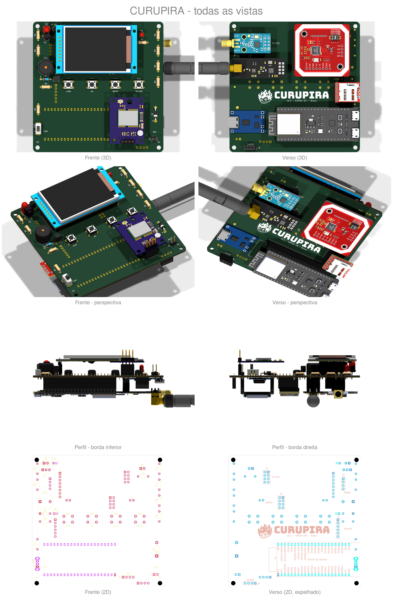

 <div align="center">
  

  # CURUPIRA

  **Dispositivo portátil estilo Cardputer rodando [Bruce](https://github.com/BruceDevices/firmware) — ESP32-S3, feito pra montar à mão (THT).**
</div>

---

## O que é

CURUPIRA é uma PCB DIY, inspirada no M5Stack Cardputer, projetada no **KiCad** para rodar o firmware **Bruce** num **ESP32-S3-DevKitC-1 (N16R8)**. O foco é um "canivete suíço" de RF/pentest de estudo, **soldável à mão** (componentes through-hole + DevKit encaixável, sem SMD).

> ⚠️ **Uso educacional / laboratório próprio.** Rádio e RF têm regras legais — use só em equipamentos e redes seus, para estudo.

## Recursos

| Bloco | Hardware | Conector |
|---|---|---|
| Cérebro | ESP32-S3-DevKitC-1 N16R8 (WiFi + BLE nativos) | U1 |
| Tela | ST7789 SPI (IPS) | J1 |
| Sub-GHz | CC1101 (433 MHz) | J3 |
| 2.4 GHz | NRF24L01+PA+LNA | J9 |
| NFC/RFID | PN532 (I2C) | J2 |
| Armazenamento | microSD (SPI, 3,3 V) | J4 |
| Infravermelho | TSOP38238 (RX) + 2× LED IR 940 nm (TX) | U2/D3/D5 |
| Teclado | M5Stack CardKB (I2C) | J8 |
| GPS (opcional) | NEO-6M / NEO-M8N (UART) | J6 |
| Energia | TP4056 (USB-C) + LiPo 3,7 V | J5 |
| Entrada | 4 botões (Prev/Sel/Next/Esc) + chave liga/desliga | SW1–SW5 |

## Estado do projeto

- **v0.4** — placa 100×100 mm (2 camadas), 4 furos M3, **roteada e com DRC limpo** (0 violações). Gerbers em `production/curupira-v0.4-gerbers-jlcpcb.zip`.
- **Novidades da v0.4:** buzzer removido (libera o GPIO3), **2 emissores de IR** (D3+D5 nos cantos de cima, mais alcance/cobertura), re-posicionamento dos componentes e **re-roteamento completo**, plano de GND costurado com vias de stitching, microSD remapeado p/ módulo 3,3 V.
- **Ainda não fabricada** — plano: validar na **protoboard** antes de mandar fazer → [plano de teste](docs/TESTE_PROTOBOARD.md).

## Renders



Para atualizar depois de mexer na placa ou no esquemático: `./renders/gerar.sh`

## Estrutura

```bash
git clone git@github.com:acacio90/curupira-diy.git
```

```
curupira-diy.kicad_pro / .kicad_sch / .kicad_pcb   → projeto KiCad
GUIA.md                 → mapa de pinos (GPIO ↔ cada conector)
production/             → Gerbers v0.4 (JLCPCB), BOM (bom.csv), lista de compras
renders/                → renders atuais da placa e do esquemático (gerar.sh recria tudo)
3d/                     → modelos 3D de todos os módulos e peças (ver 3d/LEIA-ME.md)
lib/                    → biblioteca local da Espressif (símbolo + footprint do DevKit)
docs/pinagem.html       → diagrama interativo da pinagem do ESP32 (abrir no navegador)
docs/TESTE_PROTOBOARD.md → plano de teste bloco a bloco na protoboard, antes de fabricar
arte/                   → logo CURUPIRA: rosto colorido (README), rosto e corpo em P&B (serigrafia), versões transparentes
production/LISTA_DE_COMPRAS.md → lista de compras com links e preços
```

## Como fabricar

1. Envie `production/curupira-v0.4-gerbers-jlcpcb.zip` para a JLCPCB (2 camadas, 1,6 mm, HASL).
2. Compre as peças pela `production/LISTA_DE_COMPRAS.md`.
3. Solde os THT à mão; encaixe o DevKit nas barras fêmea.
4. Confira continuidade **3V3 ↔ GND** com multímetro **antes** de ligar.

## Créditos

- Firmware: **Bruce** (BruceDevices / pr3y e colaboradores).
- Projeto de hardware: CURUPIRA.

## Licença

A definir (sugestão: hardware em **CERN-OHL-S**, docs em **CC BY-SA 4.0**).
